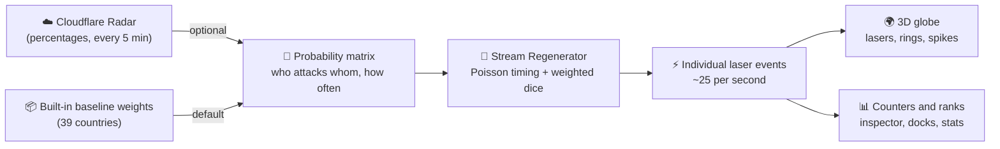
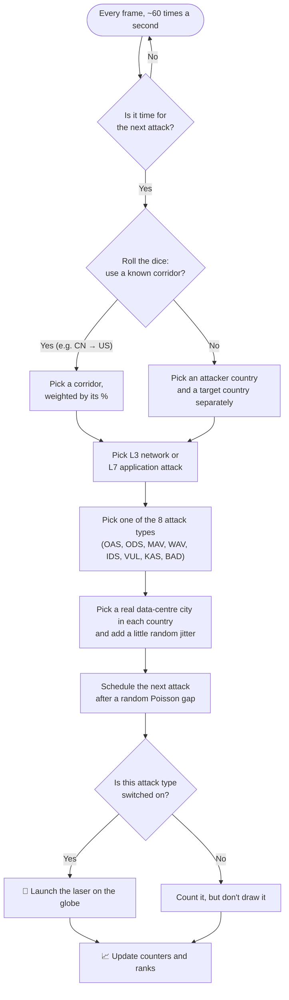
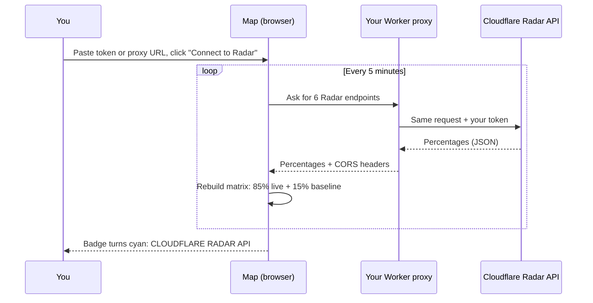
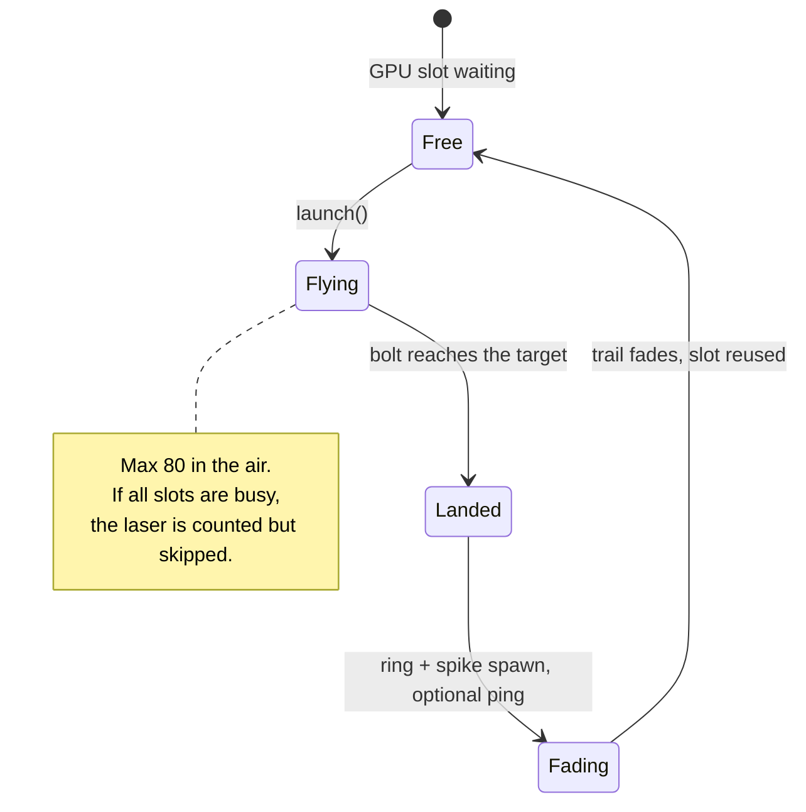
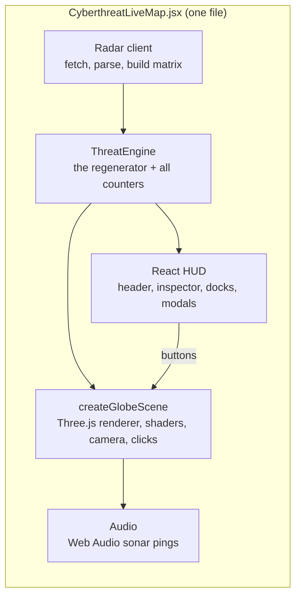
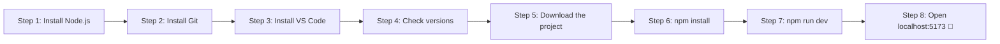
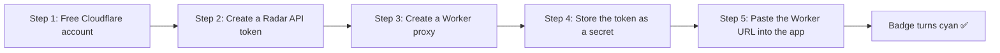

<div align="center">

# 🌐 Cyberthreat Live Map

**A real-time 3D cyberattack globe, inspired by the Kaspersky Cyberthreat Map and powered by Cloudflare Radar data.**


</div>

---

## 📖 Table of contents

1. [What is this?](#-what-is-this)
2. [Read this first: is the data real?](#%EF%B8%8F-read-this-first-is-the-data-real)
3. [Features](#-features)
4. [Screenshots](#-screenshots)
5. [How it works (with diagrams)](#-how-it-works-with-diagrams)
6. [Setup: step by step for complete beginners](#-setup-step-by-step-for-complete-beginners)
7. [How to use the map](#-how-to-use-the-map)
8. [Connecting real Cloudflare Radar data (optional)](#-connecting-real-cloudflare-radar-data-optional)
9. [Putting it online (optional)](#-putting-it-online-optional)
10. [Troubleshooting](#-troubleshooting)
11. [Customising](#%EF%B8%8F-customising)
12. [Project structure](#-project-structure)
13. [Credits](#-credits)

---

## 🤔 What is this?

It's a website that shows a **spinning 3D globe** with glowing **laser beams** flying between countries. Each laser stands for a cyberattack going from one country (the attacker) to another (the target).

- The **colour** of a laser tells you the **type** of attack (for example cyan = web attacks, teal = DNS amplification floods).
- When a laser lands, the target country gets a **shockwave ring** and a **glowing spike**.
- On the left, a panel shows how many attacks a country has received today and where it ranks.
- At the bottom, eight coloured boxes let you **turn each attack type on or off**.

It works **instantly with zero setup**. You don't need an account, an API key or a backend server to see it running.

---

## ⚠️ Read this first: is the data real?

**Short answer:** the *patterns* are real (or realistic), but the *individual lasers* are generated.

Cloudflare Radar, the data source, does **not** publish a live list of every attack. It only publishes **summaries** such as:

> "Over the last 24 hours, 12% of network-layer attacks went from the US to Germany, and 9% from China to the US."

So this project includes a **Stream Regenerator**. It reads those percentages and then *randomly produces individual lasers that follow the same proportions*. If 12% of real attacks are US → Germany, then roughly 12% of the lasers you see will be US → Germany.

| Mode | Where the percentages come from | Badge in the top-left |
|---|---|---|
| **Baseline** (default) | Built-in realistic weights for 39 major countries | `LIVE STREAM REGENERATOR` (green) |
| **Cloudflare Radar** | Real Cloudflare Radar data, refreshed every 5 minutes | `CLOUDFLARE RADAR API` (cyan) |

> 💡 Think of it like a weather animation: the forecast is real, but the individual raindrops on screen are drawn to *match* the forecast, not filmed one by one.

---

## ✨ Features

### 🌍 The globe

| Feature | What it does |
|---|---|
| **3D interactive globe** | Drag to spin, scroll to zoom, pinch on touch screens. |
| **2D tactical map** | The globe smoothly *unfolds* into a flat world map. |
| **Top-down polar view** | Look straight down at the North Pole. |
| **Laser arcs** | Bright bolts that fly along the real curved path between two cities, with a fading trail. Longer distance = higher arc. |
| **Impact effects** | Expanding shockwave rings and glowing pillars where a laser lands. |
| **Heat glow** | The most-attacked countries get a faint red tint. |
| **Hover and click** | Hover a country to see its rank; click to open its full report. |
| **Starfield + atmosphere** | A glowing green atmosphere and twinkling stars around the planet. |

### 📊 The dashboard (HUD)

| Feature | What it does |
|---|---|
| **Header** | Live attacks-per-second (APS), session total, and tabs for Map, Statistics, Data Sources and API Config. |
| **Country inspector** | Opens on **India** by default. Shows its live rank (`#3 MOST-ATTACKED COUNTRY`), detections per attack type since 00:00 GMT, and the current inbound rate. |
| **More details** | A per-second sparkline and the most likely attacking countries. |
| **Share and export** | Copy a text summary, or download the country's numbers as JSON. |
| **Filter dock** | Eight colour-coded boxes with live counters. Click one to hide or show that attack type. |
| **Control dock** | Globe / flat / polar, zoom in and out, re-centre, Demo mode, sound on/off. |
| **Demo mode** | Slowly orbits and jumps to the next top-attacked country every 10 seconds, like a security-centre wall screen. |
| **Statistics tab** | Totals per attack type, top 10 targets, top 10 attackers, latest events. |
| **Data Sources tab** | Endpoint status, and a heatmap of the attacker → target probability matrix. |
| **API Config tab** | Paste a Cloudflare token or proxy, pick a time window, set the laser rate (5–60 per second). |
| **Sound** | Optional quiet sonar "ping" on each impact (off by default). |

### 🎨 The 8 attack types

| Code | Colour | Meaning | Comes from |
|---|---|---|---|
| `OAS` | 🟢 Neon green `#00ff66` | Botnet probes | Bot-management / IP-reputation blocks |
| `ODS` | 🔴 Crimson `#ff2a55` | Port and vulnerability scans | ICMP floods |
| `MAV` | 🟠 Amber `#ff9900` | Phishing and SMTP floods | Access rules, data-loss prevention |
| `WAV` | 🔵 Cyan `#00e5ff` | Layer-7 HTTP DDoS | L7 DDoS mitigation |
| `IDS` | 🟣 Magenta `#ff00aa` | SYN and TCP floods | TCP attacks |
| `VUL` | 🟪 Purple `#b829ff` | Exploits and RCE attempts | WAF and API Shield |
| `KAS` | 🩵 Teal `#00ffcc` | DNS and NTP amplification | UDP attacks |
| `BAD` | 🔷 Royal blue `#3b82f6` | BGP hijacks and route anomalies | GRE attacks |

### ⚡ Performance

- Up to **80 lasers**, **160 rings** and **64 spikes** on screen at once, using fixed GPU "slots" that are reused. Nothing new is created while it animates, so there are no memory leaks.
- The animation loop never touches React. The dashboard refreshes 4 times a second, separately.
- All the maths for the globe and the flat map runs on the graphics card.
- Respects your system's **reduced motion** setting.
- Includes a built-in copy of the world map, so it works even offline.

---

## 🖼️ Screenshots

| Country inspector with "More details" | 2D tactical map |
|---|---|
|  |  |

| Top-down polar view | Statistics tab |
|---|---|
|  |  |

| Data Sources tab (probability matrix) | API Config tab |
|---|---|
|  |  |

---

## 🧠 How it works (with diagrams)

### The big picture



### Step by step: how one laser is born



> **Poisson timing in plain English:** real attacks don't arrive on a neat clock. Sometimes three land at once, sometimes there's a pause. Poisson timing copies that natural randomness. The rate also drifts slowly and has occasional bursts, so it feels alive.

### What happens when you add a Cloudflare token



> **Why a proxy?** Browsers block websites from calling Cloudflare's API directly (this is called **CORS**). A tiny free Cloudflare Worker sits in the middle and adds the permission headers. The code for it is inside the app.

### Life of a laser on screen



### How the code is organised



---

## 🚀 Setup: step by step for complete beginners

> ⏱️ Takes about **10 minutes** the first time. Follow every step in order. Don't skip any.



### Step 1: Install Node.js

Node.js lets your computer run the tools that build the website.

1. Go to **https://nodejs.org**.
2. Click the big **LTS** download button (LTS = the stable version).
3. Open the downloaded file and click **Next** on every screen until it finishes.

### Step 2: Install Git

Git downloads the project from GitHub.

1. Go to **https://git-scm.com/downloads**.
2. Download the version for your system and install it, clicking **Next** on every screen.

### Step 3: Install VS Code

VS Code is the code editor you'll type commands into.

1. Go to **https://code.visualstudio.com**, download it and install it.

### Step 4: Check everything installed

1. Open **VS Code**.
2. At the top, click **Terminal → New Terminal**. A panel opens at the bottom.
3. Type each line below and press **Enter** after each one:

```bash
node -v
```
```bash
npm -v
```
```bash
git --version
```

✅ **You should see version numbers** like `v22.12.0`, `10.9.0`, `git version 2.47.0`.

❌ **If you see "not recognized"**, close VS Code completely, open it again, and retry. If it still fails, reinstall that program.

### Step 5: Download the project

In the same terminal, type:

```bash
git clone https://github.com/sinchanmondal/cyberthreat-live-map.git
```

Then go into the folder:

```bash
cd cyberthreat-live-map
```

✅ The line before your cursor should now end with `cyberthreat-live-map>`.

> 📂 Also open the folder in VS Code: **File → Open Folder** → choose `cyberthreat-live-map`. This stops VS Code from showing fake red errors.

### Step 6: Install the project's packages

```bash
npm install
```

⏳ This downloads everything the project needs. It can take **1 to 3 minutes**. A small spinning character means it's working. **Wait** until you see something like:

```
added 50 packages in 30s
found 0 vulnerabilities
```

and the prompt (`...cyberthreat-live-map>`) comes back.

### Step 7: Start the website

```bash
npm run dev
```

✅ You'll see something like:

```
  VITE v7.x  ready in 400 ms

  ➜  Local:   http://localhost:5173/
  ➜  Network: use --host to expose
```

### Step 8: Open it

1. Hold **Ctrl** (or **Cmd** on Mac) and click the `http://localhost:5173/` link, **or** open Chrome / Edge / Brave and type `localhost:5173` in the address bar.
2. 🎉 The globe should appear and start firing lasers.

> 🛑 **Keep the terminal open** while you use the map. Closing it (or pressing **Ctrl + C**) turns the website off. To start it again later, open the folder in VS Code and run `npm run dev` again.

### ⚠️ The #1 beginner mistake

**Don't paste many commands at once.** If you paste several lines together, the terminal may run the first one and swallow the rest, or start the server and ignore everything after it. **One command, press Enter, wait for it to finish, then the next.**

---

## 🎮 How to use the map

| I want to… | Do this |
|---|---|
| Spin the globe | Click and drag on it |
| Zoom | Mouse scroll, pinch, or the **+** / **−** buttons on the right |
| See a country's report | **Click** the country, or type its name in **"Jump to another country"** and press Enter |
| See a quick rank | **Hover** over a country |
| See where attacks on a country come from | In the left panel, click **More details** |
| Copy a country's summary | Click the **share** icon in the left panel |
| Download the numbers | Click the **download** icon (saves a `.json` file) |
| Hide one type of laser | Click its box in the **bottom dock** (it dims and gets crossed out) |
| Switch to a flat map | Click the **map** icon on the right |
| Look down at the North Pole | Click the **compass** icon on the right |
| Re-centre on the selected country | Click the **crosshair** icon |
| Let it run like a TV display | Click **DEMO** (it says `ON` when active) |
| Hear impacts | Click the **speaker** icon (sound is off by default) |
| More or fewer lasers | **API CONFIG** tab → **Laser emission rate** slider (5–60 per second) |
| See totals and rankings | **STATISTICS** tab |
| Close a popup | Click the **X**, click outside it, or press **Esc** |

> 💡 Leave the globe alone for 5 seconds and it starts rotating slowly by itself.

---

## ☁️ Connecting real Cloudflare Radar data (optional)

**You can skip this entire section.** The map works fine without it. Do it only if you want the percentages to come from real Cloudflare data.



### Step 1: Make a free Cloudflare account

Sign up at **https://dash.cloudflare.com/sign-up**. No credit card is needed.

### Step 2: Create an API token

1. In the Cloudflare dashboard, click your **profile icon** (top right) → **My Profile** → **API Tokens**.
2. Click **Create Token**.
3. Scroll down and choose **Create Custom Token** → **Get started**.
4. Give it a name, like `radar-map`.
5. Under **Permissions**, set the three dropdowns to **Account** → **Radar** → **Read**.
6. Click **Continue to summary**, then **Create Token**.
7. **Copy the token now** and keep it somewhere safe. Cloudflare only shows it once.

> 🔒 Never put this token in your code or commit it to GitHub.

### Step 3: Create the Worker proxy

1. Open the map in your browser → **API CONFIG** tab → click **Copy code** next to "Worker proxy for Radar".
2. In the Cloudflare dashboard, open **Workers & Pages** from the left menu.
3. Click **Create** → create a Worker from the **Hello World** starter → give it a name like `radar-proxy` → **Deploy**.
4. Click **Edit code**, delete everything in the editor, **paste** the code you copied, and click **Deploy**.
5. Copy your Worker's address. It looks like `https://radar-proxy.YOUR-NAME.workers.dev`.

### Step 4: Store the token inside the Worker (recommended)

This keeps your token away from the browser.

1. Open your Worker → **Settings** → **Variables and Secrets** → **Add**.
2. Type: **Secret**. Name: `CF_API_TOKEN` (exactly like this). Value: paste your token.
3. Save and deploy.

### Step 5: Connect the map

1. In the map, open **API CONFIG**.
2. Paste your Worker address into **CORS proxy URL**.
3. Leave the token box **empty** if you did Step 4. Otherwise paste the token there too.
4. Click **Connect to Radar**.

✅ After a few seconds you'll see **"Matrix updated from Radar at …"**, and the badge at the top-left turns cyan and says `CLOUDFLARE RADAR API`. The **DATA SOURCES** tab shows a green `OK` for each endpoint.

| Message you see | What it means | Fix |
|---|---|---|
| "The browser blocked the request…" | You pasted only a token, with no proxy | Do Steps 3–5 |
| "Cloudflare rejected the token…" | Wrong token, or missing Radar permission | Redo Step 2 with **Account → Radar → Read** |
| "Paste a Cloudflare API token, or a proxy URL…" | Both boxes are empty | Fill in at least the proxy URL |

To go back to the built-in data, click **Use baseline weights**.

<details>
<summary><b>📡 Which Radar endpoints are used?</b> (click to expand)</summary>

| Feed | Path |
|---|---|
| L3 origin → target pairs | `/radar/attacks/layer3/top/attacks` |
| L7 origin → target pairs | `/radar/attacks/layer7/top/attacks` |
| L3 top target locations | `/radar/attacks/layer3/top/locations/target` |
| L3 top origin locations | `/radar/attacks/layer3/top/locations/origin` |
| L3 protocol mix | `/radar/attacks/layer3/timeseries_groups/protocol` |
| L7 mitigation product mix | `/radar/attacks/layer7/summary/mitigation_product` |

All are called with `dateRange=1d` (or 2d / 7d, chosen in the app) every 5 minutes.
</details>

---

## 🌐 Putting it online (optional)

Get a public link like `cyberthreat-live-map.vercel.app` that anyone can open:

1. Go to **https://vercel.com** and **sign in with GitHub**.
2. Click **Add New → Project**.
3. Find `cyberthreat-live-map` and click **Import**.
4. Vercel detects Vite automatically. Don't change anything. Click **Deploy**.
5. Wait about a minute. You'll get your link. 🎉

Every time you `git push` new changes, Vercel updates the site automatically.

---

## 🩺 Troubleshooting

| Problem | Why it happens | Fix |
|---|---|---|
| `'npm' is not recognized` | Node.js isn't installed, or VS Code was open during install | Install Node.js (Step 1), then **fully close and reopen** VS Code |
| `npm error code ETIMEDOUT` | Your internet can't reach the npm servers in time (common on college Wi-Fi or a VPN) | Run `npm install --fetch-timeout=600000 --fetch-retries=5`. Still failing? Switch to a **mobile hotspot** |
| `npm install` seems frozen | Big downloads plus antivirus scanning, normal on Windows | Wait up to 5 minutes. Still stuck? **Ctrl + C**, then run it again |
| Hundreds of red errors in VS Code | VS Code is showing a file from outside the project, or packages aren't installed yet | **File → Open Folder** → pick the project folder, then run `npm install` |
| Terminal shows `➜ press h + enter to show help` and won't take commands | The dev server is running and "owns" that terminal | Either use it (it's working!) or click **+** in the terminal panel to open a second terminal |
| `Port 5173 is in use` | The site is already running in another terminal | Use the link Vite prints (it may be `5174`), or close the other terminal |
| Blank black screen | Your browser has WebGL / hardware acceleration turned off | Chrome: **Settings → System → Use graphics acceleration when available** → turn on, restart the browser |
| Message: "WebGL isn't available…" | Same as above | Same as above, or try a different browser |
| Map is choppy | Built-in VS Code browser or a weak GPU | Open it in **Chrome / Edge**, or lower the laser rate in **API CONFIG** |
| No sound | Sound is off by default | Click the **speaker** icon on the right |
| Layout looks unstyled (no spacing, plain text) | Tailwind isn't connected | Check that `src/index.css` contains `@import "tailwindcss";` and `vite.config.js` includes `tailwindcss()` |

---

## 🛠️ Customising

Open `src/CyberthreatLiveMap.jsx`. Near the top there's a **Constants** section:

| Constant | Default | What it changes |
|---|---|---|
| `BASE_RATE` | `25` | Lasers per second when the page opens |
| `MAX_ARCS` | `80` | Maximum lasers on screen at once |
| `MAX_RINGS` | `160` | Maximum shockwave rings |
| `MAX_SPIKES` | `64` | Maximum impact pillars |
| `DPE` | `48` | Average real "detections" each laser represents (makes the counters bigger) |
| `ROLL_TAU` | `90` | Seconds of history used for the "most attacked" ranking |
| `POLL_MS` | `5 × 60 × 1000` | How often Cloudflare Radar is polled (milliseconds) |

Other easy changes:

- **Colours:** edit the `C` object (background, land, neon) and the `VECTORS` list (laser colours).
- **Which country opens first:** search for `useState("IN")` and change `"IN"` to another two-letter code, like `"US"`.
- **Attack patterns:** edit `HUBS` (countries, weights, city coordinates) and `BASE_PAIRS` (famous attacker → target routes).

Save the file and the browser updates by itself.

---

## 📁 Project structure

```
cyberthreat-live-map/
├── docs/
│   └── screenshots/          ← images used in this README
├── public/                   ← static files (favicon)
├── src/
│   ├── CyberthreatLiveMap.jsx  ← ⭐ the whole app (engine, globe, dashboard)
│   ├── App.jsx               ← just loads CyberthreatLiveMap
│   ├── main.jsx              ← starts React
│   └── index.css             ← loads Tailwind
├── index.html                ← the page the browser opens
├── package.json              ← list of packages and commands
├── vite.config.js            ← connects React + Tailwind to Vite
└── README.md                 ← you are here
```

### Tech stack

| Tool | Used for |
|---|---|
| [React](https://react.dev) | The dashboard and buttons |
| [Three.js](https://threejs.org) | The 3D globe, with custom GLSL shaders |
| [Vite](https://vite.dev) | Running and building the site |
| [Tailwind CSS](https://tailwindcss.com) | Layout |
| [Lucide](https://lucide.dev) | Icons |
| Web Audio API | Sonar pings |
| [Cloudflare Radar API](https://developers.cloudflare.com/radar/) | Real attack percentages (optional) |

---

## 🙏 Credits

- Visual idea inspired by the **Kaspersky Cyberthreat Real-Time Map**. This project isn't affiliated with Kaspersky.
- Attack statistics from **[Cloudflare Radar](https://radar.cloudflare.com)**. Not affiliated with or endorsed by Cloudflare.
- Country shapes from **[Natural Earth](https://www.naturalearthdata.com)** (public domain), via the `react-globe.gl` example dataset.
- Fonts: **JetBrains Mono** and **Share Tech Mono** from Google Fonts.

<div align="center">

Made by **[@sinchanmondal](https://github.com/sinchanmondal)** · ⭐ Star the repo if you like it!

</div>
